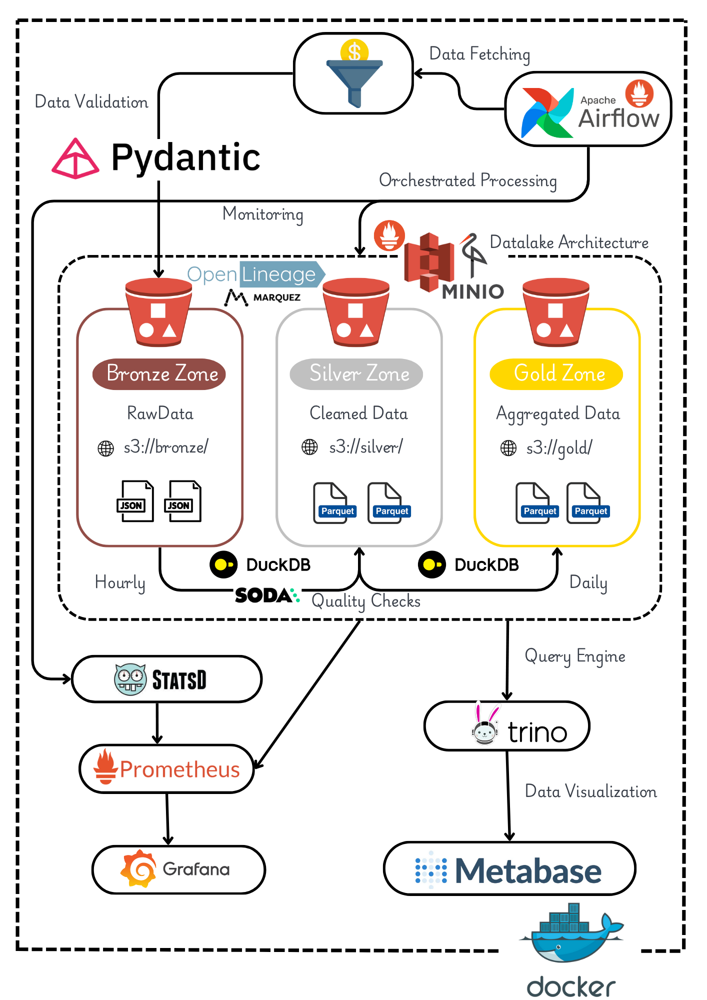

# **NewlineX — Batch Data Pipeline with Airflow, DuckDB, Delta Lake, Trino and Metabase**

     

---

## **📖 Overview**
This project demonstrates a **batch data pipeline** following the **Medallion Architecture** (Bronze → Silver → Gold). It showcases how to ingest, clean, validate, aggregate, and visualize sales data using modern data engineering tools, all containerized with Docker for easy deployment.

🔎 **Technologies Used:**

- **Orchestration:** [Apache Airflow](https://airflow.apache.org/)
- **Data Processing:** [DuckDB](https://duckdb.org/)
- **Data Lake Format:** [Delta Lake](https://delta.io/)
- **Object Storage:** [MinIO (S3-compatible)](https://min.io/)
- **Query Engine:** [Trino](https://trino.io/)
- **Visualization:** [Metabase](https://www.metabase.com/)
- **Data Quality:** [Soda Core](https://www.soda.io/)
- **Lineage:** [OpenLineage](https://openlineage.io/) + [Marquez](https://marquezproject.ai/)
- **Observability:** [Prometheus](https://prometheus.io/) + [Grafana](https://grafana.com/)

This pipeline is perfect for **data engineers** and **students** interested in learning how to design batch data systems with data quality, observability, and lineage tracking.

---

## **🏗️ Architecture**



### **Data Flow:**

1. **Data Generator** simulates realistic sales transactions with intentional data quality issues (~20% dirty data)
2. **Bronze Layer** ingests raw JSON data to MinIO without validation
3. **Silver Layer** cleans, validates, and deduplicates data into Delta Lake tables
4. **Quality Checks** validates Silver data using Soda Core with 15+ checks
5. **Gold Layer** creates business aggregations (daily sales, product performance, customer segments)
6. **Trino** provides SQL interface for querying Delta Lake tables
7. **Metabase** visualizes business metrics through interactive dashboards
8. **Marquez** tracks data lineage across the entire pipeline
9. **Grafana** monitors pipeline health and performance metrics

---

## **🛠️ Tech Stack**

| **Component**         | **Technology**                                                              | **Purpose**                                         |
|-----------------------|-----------------------------------------------------------------------------|-----------------------------------------------------|
| **Orchestration**     | [Apache Airflow](https://airflow.apache.org/)                       | DAG scheduling and task management                  |
| **Data Processing**   | [DuckDB](https://duckdb.org/)                                       | Fast analytical processing in-memory                |
| **Data Lake Format**  | [Delta Lake](https://delta.io/)                                            | ACID transactions, time travel, schema evolution    |
| **Object Storage**    | [MinIO](https://min.io/)                                                   | S3-compatible storage for Bronze/Silver/Gold layers |
| **Query Engine**      | [Trino](https://trino.io/)                                                 | Distributed SQL querying on Delta Lake             |
| **Visualization**     | [Metabase](https://www.metabase.com/)                                      | Interactive dashboards and BI                       |
| **Data Quality**      | [Soda Core](https://www.soda.io/)                                          | Data validation and quality checks                  |
| **Data Lineage**      | [Marquez](https://marquezproject.ai/) + [OpenLineage](https://openlineage.io/) | End-to-end data lineage tracking            |
| **Observability**     | [Prometheus](https://prometheus.io/) + [Grafana](https://grafana.com/)    | Metrics collection and visualization                |
| **Data Generation**   | [Faker](https://faker.readthedocs.io/) + [Faker Commerce](https://pypi.org/project/faker-commerce/) | Realistic sales data simulation |

---

## **📦 Project Structure**

```bash
newlinex-sales/
├── airflow/
│   └── dags/
│       └── sales_pipeline.py          # Main Airflow DAG
├── config/
│   └── pipeline_config.yaml           # Pipeline configuration
├── docker/
│   ├── airflow/                       # Airflow Docker setup
│   ├── grafana/                       # Grafana dashboards & datasources
│   ├── marquez/                       # Marquez lineage configuration
│   ├── metabase/                      # Metabase setup scripts
│   ├── prometheus/                    # Prometheus configuration
│   ├── statsd/                        # StatsD metrics mapping
│   └── trino/                         # Trino catalog configuration
├── docker-compose.yml                 # Docker services orchestration
├── soda/
│   └── checks.yml                     # Soda Core quality checks
└── src/
    ├── config.py                      # Configuration management
    ├── generators/
    │   └── sales_generator.py         # Synthetic data generator
    ├── models/
    │   └── schemas.py                 # Pydantic validation schemas
    ├── processors/
    │   ├── base_processor.py          # Abstract base class
    │   ├── bronze_processor.py        # Raw data ingestion
    │   ├── silver_processor.py        # Data cleaning & deduplication
    │   ├── gold_processor.py          # Business aggregations
    │   └── quality_checker.py         # Data quality validation
    └── utils/
        ├── database.py                # DuckDB connection manager
        ├── logger.py                  # Logging configuration
        ├── metrics.py                 # Custom Prometheus metrics
        └── storage.py                 # MinIO/S3 client
```

---

## **🔧 Setup Instructions**

### **1. Prerequisites**

- **Docker** and **Docker Compose** installed
- Minimum **8GB RAM** recommended
- **Git** for cloning the repository
